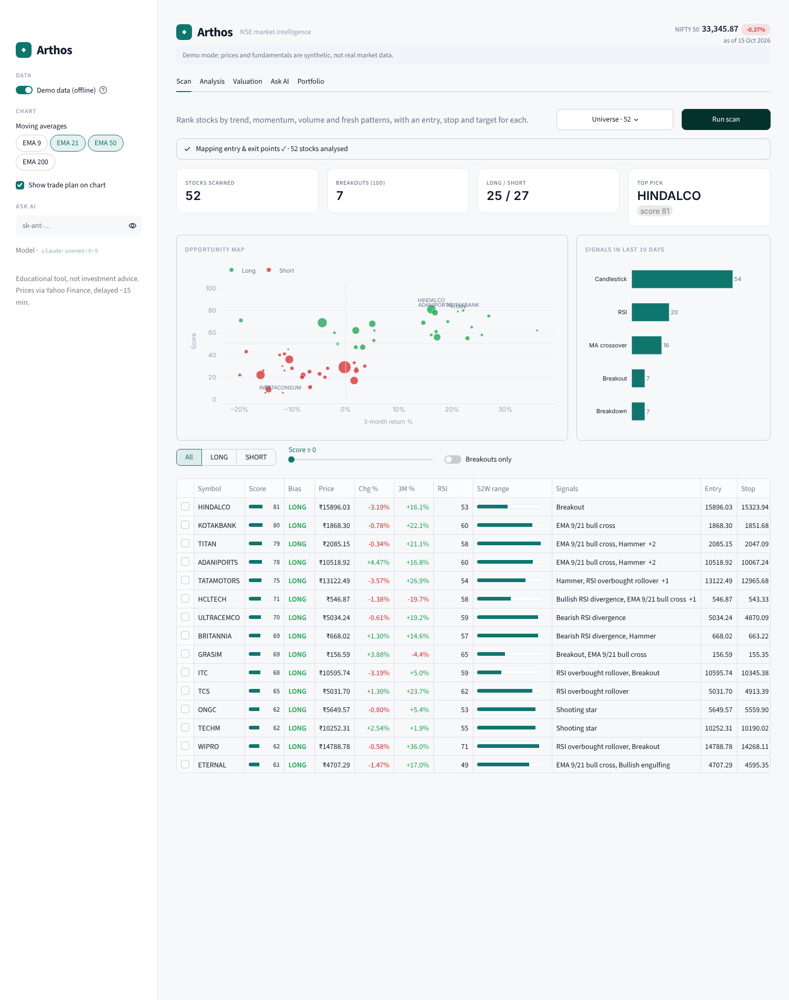
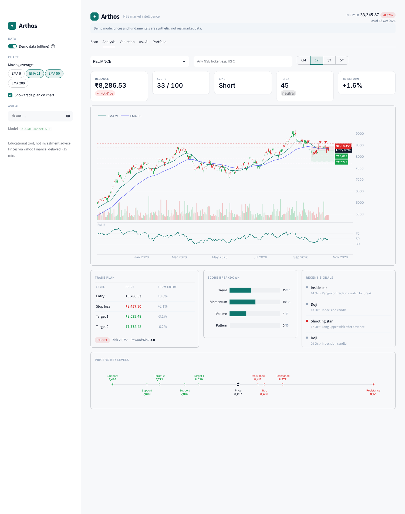

# Arthos

**NSE market intelligence.** Arthos scans the Nifty 50, finds patterns and breakouts, maps entry, stop and target for each stock, shows valuation bands and lets you ask Claude about any stock.




It does the following:

1. **Scans the market**: runs the whole Nifty 50 (or any list you pick) in one batched download
2. **Identifies patterns**:
   - EMA 9/21 crosses, plus golden and death crosses
   - RSI oversold/overbought and divergence
   - Engulfing, hammer, shooting star, doji and inside-bar candles
3. **Finds opportunities**: scores each stock from 0 to 100 on trend, momentum, volume and patterns
4. **Tracks breakouts**: flags closes beyond the 20-day high or low on volume above 1.5× average
5. **Maps entry and exit points**:
   - Stop is the larger of the ATR stop and the support-based stop
   - Targets are set at 1.5R and 3R, capped by resistance
   - All of these are drawn on the chart
6. **Valuation bands**: P/E and P/B history with a **Buy Zone** below the 20th percentile and a **Sell Zone** above the 80th percentile
7. **Ask AI**: Claude reads the full technical and valuation snapshot, writes a trade thesis and answers follow-up questions
8. **Portfolio**: a Momentum / Nifty 50 ETF / Quality allocation built from the scan, shown as a pie chart with quantities per ₹ of capital

## Run

```bash
git clone https://github.com/ber04222/arthos.git
cd arthos
python -m venv .venv && source .venv/bin/activate   # Windows: .venv\Scripts\activate
pip install -r requirements.txt
export ANTHROPIC_API_KEY=sk-ant-...                  # optional, can also be pasted in the sidebar
streamlit run app.py
```

Then open http://localhost:8501.

- **Data**: comes from Yahoo Finance through `yfinance`. It is free, needs no key and is delayed by about 15 minutes. Tickers use the `.NS` suffix automatically, and you can type any NSE symbol (e.g. `IRFC`) or an index such as `^NSEI`.
- **Demo data toggle**: switches the app to synthetic prices so it runs offline. Turn it **off** to see real data.

## Files

| File | Purpose |
|---|---|
| `app.py` | Streamlit UI (5 tabs) and layout styles |
| `charts.py` | Plotly figures sharing one light theme |
| `data.py` | yfinance fetch and caching, Nifty 50 list, demo-data generator |
| `indicators.py` | EMA, RSI, MACD, ATR, Bollinger bands, volume average, 20-day high/low |
| `patterns.py` | breakout, crossover, RSI, candlestick and support/resistance detection |
| `strategy.py` | trade plan (entry/stop/targets) and score |
| `valuation.py` | historical P/E and P/B bands and verdict |
| `ai.py` | Claude prompt, context builder and streaming chat |

## Notes

- The P/E and P/B history uses the annual EPS and book value that Yahoo exposes, which usually covers about 4 years. When that data is missing, the app shows the current trailing P/E instead.
- Yahoo sometimes renames or delists NSE symbols. If a Nifty 50 name fails to load, edit `NIFTY50` in `data.py`.

> ⚠️ This is an educational tool, not investment advice. The signals are mechanical rules and the AI output can be wrong, so do your own research and manage your risk.

## Deploy (Streamlit Community Cloud, free)

1. Sign in at https://share.streamlit.io with GitHub and allow access to private repos when it asks.
2. Click **Create app → Deploy a public app from GitHub**:
   - Repository: `ber04222/arthos`
   - Branch: `main`
   - Main file: `app.py`
   - Under **Advanced settings**, choose Python 3.12.
3. Optional: under **Advanced settings → Secrets**, add `ANTHROPIC_API_KEY = "sk-ant-..."` so Ask AI works without visitors pasting a key.
   - **This bills your key for every visitor's AI questions.** If you add it, set the app's sharing to **Only specific people** (App settings → Sharing).
4. Click **Deploy**. You get a URL like `https://arthos.streamlit.app`.

Pushing to `main` redeploys the app automatically.

## Use it like a phone app

Open your app URL in Chrome on Android, tap **⋮ → Add to Home screen** (or **Install app**), and Arthos opens full-screen from its own icon. On iPhone, open it in Safari and tap **Share → Add to Home Screen**.

On phones:
- The scan shows as swipe-friendly cards instead of the wide table.
- The tab bar stays pinned at the top.
- Charts don't capture scrolling.
- You can paste the API key directly in the Ask AI tab.

Add `?demo=1` to the URL to start in demo-data mode.
